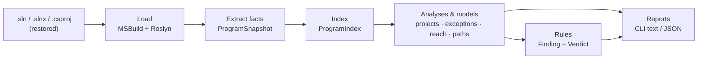

# How SharpView works

SharpView answers structural questions about an ASP.NET Core Web API by reading its C# source with the compiler (Roslyn):

- How do the projects reference each other, and how is each one built?
- Where are exceptions thrown, which ones go uncaught, which get caught where, and which slip past a `try` that doesn't match them?
- Which calls lead from a controller action down through the projects?

Every answer carries **source evidence** (file, line, column) so a person can check it, and every place where the analysis cannot decide is reported as **Unknown** rather than silently skipped.

## The pipeline



| Stage | Project | What it does |
| --- | --- | --- |
| Load | `SharpView.Roslyn` | Opens the solution with the .NET SDK. Never restores, builds or edits your code. |
| Extract facts | `SharpView.Roslyn` | Turns compiler symbols into small immutable records: types, callables, call sites, dependencies, throws, catches, implementation candidates, gaps. |
| Index | `SharpView.Core` | `ProgramIndex` builds lookups once (callers, callees, members, ancestors, candidates…) and, on first use, the whole-program `CallGraph` and type `DependencyGraph`. |
| Analyses & models | `SharpView.Core` | Queries over the index: project map, exception propagation and handling, reachability, call paths, layer graph (library only). |
| Rules | `SharpView.Core` | Plain C# functions that turn analysis results into `Finding`s. |
| Diagram export | `SharpView.Export.Mermaid` | Formats the project map and call-diagram projections as Mermaid/Markdown; owns the Mermaid NuGet dependency. |
| Reports | `SharpView.Cli` | Formats text/JSON. No analysis logic lives here. |

`SharpView.Core` depends only on `SharpView.Graph`, with no Roslyn or Mermaid dependency: once a snapshot exists (or is loaded from JSON), all analysis runs on plain records.

`SharpView.Graph` is a small generic graph library underneath Core (it knows nothing about C#): an immutable directed multigraph (`DiGraph`) with NetworkX-style operations — out/in edges, successors/predecessors, `Where` and `Subgraph` (materialized copies sharing payload), breadth-first search with shortest paths, `ReachableFrom`, `Quotient` (collapse nodes into groups such as layers) and `StronglyConnectedComponents` (cycles). Everything keeps insertion order, so results are deterministic. Reachability searches the call graph with shared parent links; witnesses materialize on demand. The layer graph is a quotient of the call and dependency graphs, with isolated groups and original node membership retained. Node identities and edge endpoints must remain stable. Cached graph accessors accept cancellation tokens and publish complete graphs only.

## Principles

1. **Declared, candidate and runtime are different things.**
   - *Declared binding* — what the source code calls, e.g. `IRepository.Read()`. Always recorded.
   - *Implementation candidate* — a source method that implements or overrides it, e.g. `SqlRepository.Read()`. Recorded separately; followed only on request and always marked "candidate".
   - *Runtime target* — what actually runs (depends on DI, receiver type…). SharpView never claims this.
2. **Unknown is a result, not an error.** Interface dispatch, missing bodies, a `finally` that can throw, tasks never awaited, depth limits… produce explicit Unknown/boundary entries with a reason.
3. **Evidence everywhere.** Facts and results point at source locations; reports can be checked by hand.
4. **Bounded and deterministic.** Depth, output and work limits are explicit flags; the same input gives byte-identical output.
5. **Structure comes from the build, not from names.** The project map is MSBuild's own reference graph and settings; naming conventions are never treated as architecture. Custom layer mappings exist only in the library, where you declare them.

## Which command answers which question

Snippets below are from the sample Web API, with names and paths shortened; the linked files are the full outputs.

| Question | Command | Output (fixture sample) |
| --- | --- | --- |
| How do projects reference each other; how is each built? | `projects` (`--mermaid`) | [projects.txt](samples/projects.txt) |
| Where is each explicit exception thrown? | `exceptions` | [exceptions.txt](samples/exceptions.txt) |
| Which exceptions may escape an action with no catch on the way? | `exceptions --uncaught` | [exceptions-uncaught.txt](samples/exceptions-uncaught.txt) |
| Which are caught, and where? | `exceptions --caught` | [exceptions-caught.txt](samples/exceptions-caught.txt) |
| Which pass through a `try` that doesn't catch them? | `exceptions --miscaught` | [exceptions-miscaught.txt](samples/exceptions-miscaught.txt) |
| What can this action reach? | `reach` | [reach.txt](samples/reach.txt) |
| What are all the call paths from an action (or any method)? | `paths` | [paths.txt](samples/paths.txt) |
| What did SharpView extract? | `inspect` (`--methods`, `--json`) | — |
| How does a coding agent learn to use SharpView? | `skill` (`--user`) | `.claude/skills/sharpview/SKILL.md` |

### When to use which command

| Need | Command |
| --- | --- |
| Orientation in an unfamiliar solution | `projects`, then `exceptions` |
| Exception-handling review | `exceptions --uncaught`, `--caught`, `--miscaught` |
| Everyday call analysis | `reach`, `diagram` |
| Every route through one small endpoint, or from a method that is not an action | `paths` |
| Lookups, coverage checks and machine-readable facts | `inspect` |

**`projects` — how is the solution put together?** The `<ProjectReference>` tree with each project's framework, `Nullable`, whether nullable (or all) warnings are errors, and compiler warning and error counts. Values come from MSBuild's evaluation, including inherited `Directory.Build.props`.

- *First look at a solution*, for a person or an agent: entry projects at the top, what each one depends on beneath it.
- *Build hygiene:* spot projects with nullable disabled, warnings not enforced, or a warning backlog.
- *Documentation:* `--mermaid` saves the same tree as a diagram with a settings table, ready for a README or design doc.

**`exceptions` — where can things go wrong?** Four views over the same throw and catch facts:

- *Default, every throw:* each explicit `throw` with its type, method and location. A map of what the code can raise, independent of any endpoint.
- *`--uncaught`:* which exceptions may leave a controller action because no catch is on the way, each with the shortest example path. Scales to a whole API, for example to find domain exceptions that reach middleware.
- *`--uncaught --strict`:* also every call into a third-party library (NuGet package or referenced DLL, not .NET itself) that no catch meets on the way from the action, in a section of its own. Any catch around the call or a caller counts, whatever its type.
- *`--caught`:* each place an exception meets a matching catch: where it is thrown, where it is caught, and what the handler does (handles, rethrows, replaces). Catches with filters or runtime-dependent matches are marked as possible.
- *`--miscaught`:* exceptions that pass through a `try` whose catch clauses don't match their type, a common sign of catching the wrong exception. Shows the clauses, and whether something further up catches it.

A `Not followed:` line on stderr says where the analysis stopped and needs a human.

*`--format msbuild`* prints the uncaught and miscaught findings (or one view's) as one MSBuild warning per line: `SV0001` may escape an action, `SV0002` may escape to a global exception handler, `SV0003` miscaught, `SV0004` third-party call with `--strict`. Run it in CI (the README has a GitLab CI job) or as a VS Code task with the `$msCompile` problem matcher; the optional `SharpView` package runs it after each build instead, so the findings also land in Visual Studio's Error List. `#pragma warning disable SV000N` and `[SuppressMessage("SharpView", "SV000N")]` at the warning's location suppress it.

**`reach` — what can this endpoint touch?** Each reachable method once, with distance and one shortest path. Its cost grows with the size of the code, not the number of paths, so it is the right default on large solutions.

- *Impact analysis:* before changing `Repository.Save()`, run `reach` over all actions to see which endpoints can get to it.
- *Architecture checks:* an Infrastructure method at distance 1 from a controller means the Application project was skipped. The rule in [Writing your own rule](#writing-your-own-rule) is built on exactly this.
- *Onboarding and review:* a flat list of everything an endpoint depends on, without wading through paths.
- *Security and audit:* can any endpoint reach `File.Delete` or a raw SQL helper? Framework methods that are called directly appear too, with `Project: metadata`.

**`paths` — every route through an endpoint.** All call paths from each action, with project, type and transitions per step.

- *Explaining one endpoint in full*, for example in a code review or design discussion, when the order of calls matters.
- *Seeing where projects are crossed:* each path shows exactly where it moves from API to Application to Infrastructure.
- *Entry points that are not controller actions:* background jobs, message handlers, `Program.Main`, library APIs and minimal-API lambdas (which are not recognised as actions). Pass any source method with `--root`.
- *Limit:* the number of paths grows exponentially. Use it on small or medium endpoints; on anything large, use `reach` or `diagram`.

**`diagram` — a picture of one endpoint.** A Mermaid call graph for pull requests, design docs or onboarding notes. It stays readable where `paths` would produce thousands of paths, because shared callees are drawn once.

**`inspect` — what did SharpView extract?**

- *Summary (default):* a quick check after loading: each project and its framework; counts of types, callables, calls, dependencies, throws, catches, actions and gaps; call sites by dispatch kind; and the exception landscape (every explicit throw and catch, with evidence).
- *`--methods`:* every source callable with its kind, body status and ID. Copy a `--root` from here: an ID or the exact signature, and the ID when overloads or lambdas share a signature. A method missing from the list was not extracted from source (for example, it lives only in a referenced assembly, or is generated code dropped by `--exclude-generated`). Look here first when a result seems wrong.
- *`--json`:* the full fact snapshot (schema v3). Use it to feed scripts, agents or dashboards without writing C# against the library, or to compare snapshots across commits, since IDs are stable keys. It also answers "was this call site extracted at all?" when debugging SharpView itself.

### `projects` — the reference tree

```text
Projects: 3. Each project is listed with the projects it references (<ProjectReference>) beneath it.
Research.Api [net10.0 | Nullable: enable | Nullable warnings as errors: no | All warnings as errors: no | Compiler warnings: 0 | Errors: 0]
└── Research.Application [net10.0 | Nullable: enable | Nullable warnings as errors: no | ...]
    └── Research.Infrastructure [net10.0 | Nullable: enable | Nullable warnings as errors: yes | ...]
```

A project referenced from several places is described once; later occurrences say `(described above)`. Warning counts are compiler diagnostics; analyzer and NuGet warnings are not included.

### `reach` — one line per reachable method

```text
Root: Research.Api.OrdersController.Get()
  [1] Research.Application.Service.Load() | Project: Research.Application
  [2] Research.Infrastructure.Repository.Read() | Project: Research.Infrastructure
    Path: OrdersController.Get() --> Service.Load() --> Repository.Read()
```

`[n]` is the number of call transitions (not stack depth). Each method appears once with one shortest allowed path after a complete search. A work-limited result retains a valid admitted path; its distance still agrees with its witness. With candidates enabled, `Distance`/`Witness` describe the shortest allowed route, while nullable `DirectDistance` and lazy `DirectWitness` preserve the direct-call-only route. `ViaCandidate` indicates no bounded direct proof was established; `WitnessUsesCandidate` describes the displayed path. Only examined sites produce per-site boundaries; a depth stop is a single boundary. Prefer `reach` over `paths` on large code: path enumeration grows exponentially, reachability does not.

### `exceptions` — four views

Every throw (default):

```text
Research.Infrastructure.StorageException  Repository.Read  Research.Infrastructure/Repository.cs:6
System.Exception (or a subclass)  Repository.StaticType  Research.Infrastructure/Repository.cs:10
```

`--caught`, where it is thrown and where it is caught. Every report that lists more than one finding starts with an
`Overview:` line and a count per exception type; findings are numbered and separated by blank lines:

```text
Overview: 7 caught exceptions
  7  Research.Infrastructure.StorageException

1. Research.Infrastructure.StorageException
   Thrown:     Repository.ReadAsync  Research.Infrastructure/Repository.cs:8
   Caught by:  Service.AwaitCaught  Research.Application/Service.cs:14
               catch (Research.Infrastructure.StorageException)
   Handler:    handles it
   Path:       OrdersController.AwaitCaught -> Service.AwaitCaught -> Repository.ReadAsync
```

`--miscaught`, a `try` that did not catch it:

```text
Handled by a global exception handler:
  - UseExceptionHandler  Research.Api/Program.cs:5

1. Research.Infrastructure.StorageException
   Thrown:     Repository.Read  Research.Infrastructure/Repository.cs:6
   Missed by:  Service.Incompatible  Research.Application/Service.cs:8
               try { ... } catch (System.ArgumentException)
   Then:       may escape the controller action
   Path:       OrdersController.Incompatible -> Service.Incompatible -> Repository.Read
```

`--uncaught`, one entry per exception type escaping from one method (its throw lines listed together), with an example path from an action; `Escapes:` lists the actions when
there is more than the one the path starts at:

```text
2. Research.Infrastructure.StorageException
   Thrown:     Repository.Read  Research.Infrastructure/Repository.cs:6
   Escapes:    OrdersController.Filter, OrdersController.Get, OrdersController.Incompatible and 1 more
   Path:       OrdersController.Filter -> Service.Filter -> Repository.Read
```

A path stays on one line while it fits in 120 columns, otherwise it continues one call per line. `~>` marks a step into
an implementation found in source behind an interface or virtual call; when source has several, the step adds
`(1 of N implementations)`, since that is where the path is a guess. A path that shares at least three steps with an
earlier finding's path reads `same as 2` or `as in 2 up to <method>, then -> ...` (not under `--locations`). A throw in the action itself has no path line; its `Thrown:` line ends with
`(in the action)`. `--locations` adds a `Locations:` list.

"May escape" means no catch on the way from the action. Findings whose actions are covered by registered exception middleware or a global exception filter are listed last, under a `Handled by a global exception handler:` header that lists the registrations. A catch is *miscaught* only when every clause definitely does not match; filters and runtime-dependent matches are possible catches instead.

## Writing your own rule

A rule is a function over the index (and optionally derived models) that returns `Finding`s:

```csharp
// "Controllers must not reach Infrastructure directly."
static IEnumerable<Finding> NoDirectInfrastructure(ProgramIndex index, LayerMap layers)
{
    var actions = AspNetConventions.ControllerActions(index).Select(x => x.Method).ToImmutableArray();
    foreach (var root in ReachabilityQuery.Analyze(index, actions, new ReachOptions(FollowCandidates: true)).Roots)
        foreach (var hit in root.Reached.Where(x => x.DirectDistance == 1 && layers.LayerOf(x.Callable) == "Infrastructure"))
            yield return new("no-direct-infrastructure", Verdict.Violation,
                index.Callable(root.Root).DisplaySignature, $"Calls {index.Callable(hit.Callable).DisplaySignature} directly.",
                [index.CallSite(hit.DirectWitness[0].Site).Evidence]);
}
```

Even with candidates enabled, this rule uses `DirectDistance == 1` and `DirectWitness` for its violation and evidence. A candidate shortcut cannot turn a longer direct route into a direct-call violation. Candidate possibilities can be evaluated separately as Unknown; this example enforces direct calls only.

Building blocks: `ProgramIndex` (lookups, `CallGraph`, `DependencyGraph`), `SharpView.Graph` algorithms, `ProjectMap` (MSBuild references and settings), `LayerMap`/`LayerGraph` (your own layer mapping, library only), `ReachabilityQuery`, `CallChainQuery`, `ExceptionQuery` (with `ExceptionReason` codes), `ExceptionHandlingQuery` (caught/miscaught), `AspNetConventions`. Keep `Verdict.Unknown` separate from `Pass` — it is how a rule stays honest.

## Glossary

| Term | Meaning |
| --- | --- |
| Callable | Anything with a body: method, constructor, accessor, operator, local function, lambda. |
| Call site | One call in source, with its declared target and dispatch kind (direct, interface, virtual, delegate, dynamic). |
| Transition / distance | One call edge. Not runtime stack depth. |
| Witness | A concrete path plus source locations that justifies a result. |
| Boundary | Where traversal stopped and why (dispatch, missing body, unresolved, depth/work limit). |
| Gap | Something extraction could not model (e.g. top-level statements). `inspect` lists them all; other commands mention one only when it affects their result. |
| Key | Portable identity (`<project>\|<documentation ID>`); IDs are local to one analysis run. |

## Further reading

- [Analysis coverage and limits](coverage.md) — what is and is not modelled.
- [Model reference](model.md) — facts, identities and query semantics in detail.
- [Validation](validation.md) — which tests prove which behaviour.
- [Sample reports](samples/README.md) — full outputs on the fixture.
- [Lessons learned](lessons.md) — why the first real-project run was noise, and the rules that came out of it.

## Summary analysis and diagram projections

`ExceptionSummaryQuery` keeps possible escape effects beside the immutable call graph. It processes direct-call SCCs
bottom-up and joins finite, origin-preserving effects until stable. Catch/rethrow/replacement, awaited calls and unsupported
flow use the same transfer code as detailed exception witnesses. Per-call-site crossing summaries prevent a catch at one
site from hiding effects at another. Budgets bound retained facts and transfer work; uncertainty remains explicit. Ownerless gaps stay in result-level `GlobalGaps`, separate from action effects; overall `IsComplete` accounts for them. Complexity
depends on the number of distinct effects, call sites and fixed-point transfers, rather than just the node/edge count.

`CallDiagramQuery` projects a bounded action subgraph without enumerating all paths. `MermaidExporter` in `SharpView.Export.Mermaid` formats that projection;
it does not infer layers or analyze exception behavior. The CLI `diagram` command supplies selection and safe file output.
Project groups are labels for source ownership; collapsed project/layer graphs must never replace the method graph for
reachability or exception propagation. See [the implementation change document](changes/2026-10-18-graph-analysis-and-mermaid.md)
for contracts, defaults, regressions and limitations.
