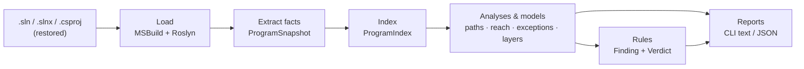

# How Sharpview works

Sharpview answers structural questions about an ASP.NET Core Web API by reading its C# source with the compiler (Roslyn):

- Which calls lead from a controller action down through the architectural layers?
- Which explicit exceptions can reach an action, and which handlers stand in between?
- Which layers depend on which, and does that match the intended architecture?

Every answer carries **source evidence** (file, line, column) so a person can check it, and every place where the analysis cannot decide is reported as **Unknown** rather than silently skipped.

## The pipeline



| Stage | Project | What it does |
| --- | --- | --- |
| Load | `Sharpview.Roslyn` | Opens the solution with the .NET SDK. Never restores, builds or edits your code. |
| Extract facts | `Sharpview.Roslyn` | Turns compiler symbols into small immutable records: types, callables, call sites, dependencies, throws, catches, implementation candidates, gaps. |
| Index | `Sharpview.Core` | `ProgramIndex` builds lookups once (callers, callees, members, ancestors, candidates…) and, on first use, the whole-program `CallGraph` and type `DependencyGraph`. |
| Analyses & models | `Sharpview.Core` | Queries over the index: call paths, reachability, exception propagation, layer graph. |
| Rules | `Sharpview.Core` | Plain C# functions that turn analysis results into `Finding`s. |
| Diagram export | `Sharpview.Export.Mermaid` | Formats Core diagram projections as Mermaid/Markdown; owns the Mermaid NuGet dependency. |
| Reports | `Sharpview.Cli` | Formats text/JSON. No analysis logic lives here. |

`Sharpview.Core` depends only on `Sharpview.Graph`, with no Roslyn or Mermaid dependency: once a snapshot exists (or is loaded from JSON), all analysis runs on plain records.

`Sharpview.Graph` is a small generic graph library underneath Core (it knows nothing about C#): an immutable directed multigraph (`DiGraph`) with NetworkX-style operations — out/in edges, successors/predecessors, `Where` and `Subgraph` (materialized copies sharing payload), breadth-first search with shortest paths, `ReachableFrom`, `Quotient` (collapse nodes into groups such as layers) and `StronglyConnectedComponents` (cycles). Everything keeps insertion order, so results are deterministic. Reachability searches the call graph with shared parent links; witnesses materialize on demand. The layer graph is a quotient of the call and dependency graphs, with isolated groups and original node membership retained. Node identities and edge endpoints must remain stable. Cached graph accessors accept cancellation tokens and publish complete graphs only.

## Principles

1. **Declared, candidate and runtime are different things.**
   - *Declared binding* — what the source code calls, e.g. `IRepository.Read()`. Always recorded.
   - *Implementation candidate* — a source method that implements or overrides it, e.g. `SqlRepository.Read()`. Recorded separately; followed only on request and always marked "candidate".
   - *Runtime target* — what actually runs (depends on DI, receiver type…). Sharpview never claims this.
2. **Unknown is a result, not an error.** Interface dispatch, missing bodies, catch filters, `finally`, unobserved tasks, depth limits… produce explicit Unknown/boundary entries with a reason.
3. **Evidence everywhere.** Facts and results point at source locations; reports can be checked by hand.
4. **Bounded and deterministic.** Depth, output and work limits are explicit flags; the same input gives byte-identical output.
5. **Architecture comes from you.** Layers exist only through your mappings (`--layer`); naming conventions are never treated as truth.

## Which command answers which question

Snippets below are from the sample Web API, with names and paths shortened; the linked files are the full outputs.

| Question | Command | Output (fixture sample) |
| --- | --- | --- |
| What can this action reach, and through which layers? | `reach` | [reach.txt](samples/reach.txt) |
| What are all the call paths from an action (or any method)? | `paths` | [paths.txt](samples/paths.txt) |
| Which explicit exceptions can escape an action? | `exceptions` (summary) / `exceptions --paths` | [exceptions.txt](samples/exceptions.txt) |
| How do layers depend on each other; are rules broken? | `layers` (+ `--allow`) | [layers.txt](samples/layers.txt) |
| What did Sharpview extract? | `inspect` (`--methods`, `--json`) | — |

### When to use which command

| Need | Command |
| --- | --- |
| Everyday analysis | `reach`, `exceptions`, `layers`, `diagram` |
| Every route through one small endpoint, or from a method that is not an action | `paths` |
| Lookups, coverage checks and machine-readable facts | `inspect` |

**`reach` — what can this endpoint touch?** Each reachable method once, with distance and one shortest path. Its cost grows with the size of the code, not the number of paths, so it is the right default on large solutions.

- *Impact analysis:* before changing `Repository.Save()`, run `reach` over all actions to see which endpoints can get to it.
- *Architecture checks:* an Infrastructure method at distance 1 from a controller means the Application layer was skipped. The rule in [Writing your own rule](#writing-your-own-rule) is built on exactly this.
- *Onboarding and review:* a flat list of everything an endpoint depends on, without wading through paths.
- *Security and audit:* can any endpoint reach `File.Delete` or a raw SQL helper? Framework methods that are called directly appear too, with `Project: metadata`.

**`paths` — every route through an endpoint.** All call paths from each action, with project, layer and transitions per step.

- *Explaining one endpoint in full*, for example in a code review or design discussion, when the order of calls matters.
- *Seeing where layers are crossed:* each path shows exactly where it moves from API to Application to Infrastructure.
- *Entry points that are not controller actions:* background jobs, message handlers, `Program.Main`, library APIs and minimal-API lambdas (which are not recognised as actions). Pass any source method with `--root`.
- *Limit:* the number of paths grows exponentially. Use it on small or medium endpoints; on anything large, use `reach` or `diagram`.

**`exceptions` — what can escape an endpoint?** The default summary scales to a whole API, for example to find actions that may let a domain exception through to middleware; each escaping origin comes with one example path. Add `--paths` to review the path, handlers and status of each throw in one endpoint. Any *Unknown* entry says where the analysis needs a human.

**`layers` — does the code match the intended architecture?** Without `--allow`, it prints an overview of which layers depend on which. With `--allow`, it becomes a check: violations, and unknowns for unmapped code, make the exit code 1, so it can gate CI.

**`diagram` — a picture of one endpoint.** A Mermaid call graph for pull requests, design docs or onboarding notes. It stays readable where `paths` would produce thousands of paths, because shared callees are drawn once.

**`inspect` — what did Sharpview extract?**

- *Summary (default):* a quick check after loading: each project and its framework; counts of types, callables, calls, dependencies, throws, catches, actions and gaps; call sites by dispatch kind; and the exception landscape (every explicit throw and catch, with evidence).
- *`--methods`:* every source callable with its kind, body status and ID. Copy a `--root` from here: an ID or the exact signature, and the ID when overloads or lambdas share a signature. A method missing from the list was not extracted from source (for example, it lives only in a referenced assembly, or is generated code dropped by `--exclude-generated`). Look here first when a result seems wrong.
- *`--json`:* the full fact snapshot (schema v3). Use it to feed scripts, agents or dashboards without writing C# against the library, or to compare snapshots across commits, since IDs are stable keys. It also answers "was this call site extracted at all?" when debugging Sharpview itself.

### `reach` — one line per reachable method

```text
Root: Research.Api.OrdersController.Get()
  [1] Research.Application.Service.Load() | Project: Research.Application | Layer: Application
  [2] Research.Infrastructure.Repository.Read() | Project: Research.Infrastructure | Layer: Infrastructure
    Path: OrdersController.Get() --> Service.Load() --> Repository.Read()
```

`[n]` is the number of call transitions (not stack depth). Each method appears once with one shortest allowed path after a complete search. A work-limited result retains a valid admitted path; its distance still agrees with its witness. With candidates enabled, `Distance`/`Witness` describe the shortest allowed route, while nullable `DirectDistance` and lazy `DirectWitness` preserve the direct-call-only route. `ViaCandidate` indicates no bounded direct proof was established; `WitnessUsesCandidate` describes the displayed path. Only examined sites produce per-site boundaries; a depth stop is a single boundary. Prefer `reach` over `paths` on large code: path enumeration grows exponentially, reachability does not.

### `exceptions` — where each explicit throw ends up

The default summary, one entry per escaping origin with an example path:

```text
Exception summary: OrdersController.Get()
  Explicit escapes: 1; unknown effects: 1; local summary complete within model: False.
  May escape: Research.Infrastructure.StorageException | origin: … | MayEscape
    Path: OrdersController.Get() --> Service.Load() --> Repository.Read()
```

`--paths` reports each propagation path with its handlers ([exceptions-paths.txt](samples/exceptions-paths.txt)):

```text
Origin: Research.Infrastructure.Repository.Read()
Exception: Research.Infrastructure.StorageException (exact construction)
Path: OrdersController.Get() --> Service.Load() --> Repository.Read()
Status: May escape the controller action under the supported analysis model
Boundary handling: registration evidence; action interception and middleware coverage unknown
```

Statuses: **Intercepted** by a matching handler (not proof of recovery) · **Rethrown or replaced** (with what happens next) · **May escape** the action (middleware may still handle it — never called "unhandled") · **Unknown** (with a reason code).

### `layers` — the architecture at a glance

```text
Layer edge: API --> Application | DirectCall | 13 | Evidence: OrdersController.cs:8:36
Layer edge: API --> Infrastructure | TypeDependency | 1 | Evidence: OrdersController.cs:15:5
Finding [layer-dependency] Violation: API --> Infrastructure (TypeDependency)
```

Edge kinds: `DirectCall` · `DeclaredCall` (interface/virtual call, counted at the declared target) · `CandidateCall` (to an implementation candidate) · `TypeDependency` (signatures, base types, fields, properties, construction). With `--allow API=Application --allow Application=Infrastructure`, each disallowed cross-layer edge becomes a **Violation**; edges touching unmapped code are **Unknown**; candidate edges are not judged.

## Writing your own rule

A rule is a function over the index (and optionally derived models) that returns `Finding`s:

```csharp
// "Controllers must not reach Infrastructure directly."
static IEnumerable<Finding> NoDirectInfrastructure(ProgramIndex index, LayerMap layers)
{
    var actions = AspNetConventions.ControllerActions(index).Select(x => x.Method).ToImmutableArray();
    foreach (var root in ReachabilityQuery.Analyze(index, actions, new ReachOptions(FollowCandidates: true)).Roots)
        foreach (var hit in root.Reached.Where(x => x.DirectDistance == 1 && layers.LayerOf(x.Callable) == "Infrastructure"))
            yield return new("no-direct-infrastructure", Verdict.Violation,
                index.Callable(root.Root).DisplaySignature, $"Calls {index.Callable(hit.Callable).DisplaySignature} directly.",
                [index.CallSite(hit.DirectWitness[0].Site).Evidence]);
}
```

Even with candidates enabled, this rule uses `DirectDistance == 1` and `DirectWitness` for its violation and evidence. A candidate shortcut cannot turn a longer direct route into a direct-call violation. Candidate possibilities can be evaluated separately as Unknown; this example enforces direct calls only.

Building blocks: `ProgramIndex` (lookups, `CallGraph`, `DependencyGraph`), `Sharpview.Graph` algorithms, `LayerMap`/`LayerGraph` (architecture), `ReachabilityQuery`, `CallChainQuery`, `ExceptionQuery` (with `ExceptionReason` codes), `AspNetConventions`. Keep `Verdict.Unknown` separate from `Pass` — it is how a rule stays honest.

## Glossary

| Term | Meaning |
| --- | --- |
| Callable | Anything with a body: method, constructor, accessor, operator, local function, lambda. |
| Call site | One call in source, with its declared target and dispatch kind (direct, interface, virtual, delegate, dynamic). |
| Transition / distance | One call edge. Not runtime stack depth. |
| Witness | A concrete path plus source locations that justifies a result. |
| Boundary | Where traversal stopped and why (dispatch, missing body, unresolved, depth/work limit). |
| Gap | Something extraction could not model (e.g. top-level statements); listed, never hidden. |
| Key | Portable identity (`<project>\|<documentation ID>`); IDs are local to one analysis run. |

## Further reading

- [Analysis coverage and limits](coverage.md) — what is and is not modelled.
- [Model reference](model.md) — facts, identities and query semantics in detail.
- [Validation](validation.md) — which tests prove which behaviour.
- [Sample reports](samples/README.md) — full outputs on the fixture.


## Summary analysis and diagram projections

`ExceptionSummaryQuery` keeps possible escape effects beside the immutable call graph. It processes direct-call SCCs
bottom-up and joins finite, origin-preserving effects until stable. Catch/rethrow/replacement, awaited calls and unsupported
flow use the same transfer code as detailed exception witnesses. Per-call-site crossing summaries prevent a catch at one
site from hiding effects at another. Budgets bound retained facts and transfer work; uncertainty remains explicit. Ownerless gaps stay in result-level `GlobalGaps`, separate from action effects; overall `IsComplete` accounts for them. Complexity
depends on the number of distinct effects, call sites and fixed-point transfers, rather than just the node/edge count.

`CallDiagramQuery` projects a bounded action subgraph without enumerating all paths. `MermaidExporter` in `Sharpview.Export.Mermaid` formats that projection;
it does not infer layers or analyze exception behavior. The CLI `diagram` command supplies selection and safe file output.
Project groups are labels for source ownership; collapsed project/layer graphs must never replace the method graph for
reachability or exception propagation. See [the implementation change document](changes/2026-10-18-graph-analysis-and-mermaid.md)
for contracts, defaults, regressions and limitations.
