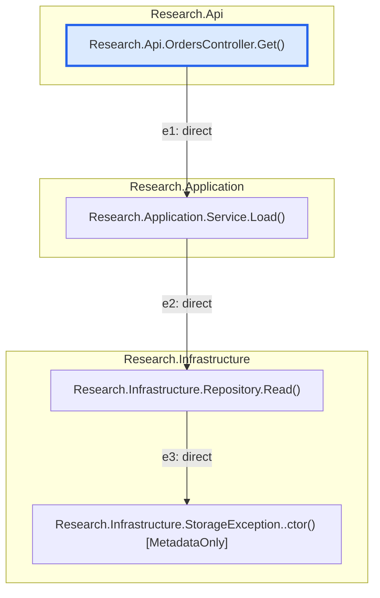

# Call diagram

Research.Api.OrdersController.Get()

Nodes: 4; edges: 3; examined call sites: 3.
Solid arrows: direct calls. Dotted arrows: declared dispatch, possible implementation candidates, or unresolved calls.
Branches show possible static calls, not execution order. Shared methods appear once; cycles represent recursion.
Implementation candidates followed: False. Completeness: partial (see boundaries, limits and gaps below).

## Call-site evidence

| Edge | Kind | Source location | Call-site ID |
| --- | --- | --- | --- |
| e1 | Direct | /home/stan/source/repos/sharpal/tests/Fixtures/ResearchSolution/Research.Api/OrdersController.cs:8:36 | /home/stan/source/repos/sharpal/tests/Fixtures/ResearchSolution/Research.Api/Research.Api.csproj&#124;Debug&#124;net10.0&#124;Research.Api, Version=1.0.0.0, Culture=neutral, PublicKeyToken=null&#124;M:Research.Api.OrdersController.Get&#124;call&#124;/home/stan/source/repos/sharpal/tests/Fixtures/ResearchSolution/Research.Api/OrdersController.cs:232:0 |
| e2 | Direct | /home/stan/source/repos/sharpal/tests/Fixtures/ResearchSolution/Research.Application/Service.cs:5:34 | /home/stan/source/repos/sharpal/tests/Fixtures/ResearchSolution/Research.Application/Research.Application.csproj&#124;Debug&#124;net10.0&#124;Research.Application, Version=1.0.0.0, Culture=neutral, PublicKeyToken=null&#124;M:Research.Application.Service.Load&#124;call&#124;/home/stan/source/repos/sharpal/tests/Fixtures/ResearchSolution/Research.Application/Service.cs:126:0 |
| e3 | Direct | /home/stan/source/repos/sharpal/tests/Fixtures/ResearchSolution/Research.Infrastructure/Repository.cs:6:39 | /home/stan/source/repos/sharpal/tests/Fixtures/ResearchSolution/Research.Infrastructure/Research.Infrastructure.csproj&#124;Debug&#124;net10.0&#124;Research.Infrastructure, Version=1.0.0.0, Culture=neutral, PublicKeyToken=null&#124;M:Research.Infrastructure.Repository.Read&#124;call&#124;/home/stan/source/repos/sharpal/tests/Fixtures/ResearchSolution/Research.Infrastructure/Repository.cs:205:0 |

## Analysis boundaries

- MissingBody: Research.Infrastructure.StorageException..ctor()

## Coverage

Source-backed call relationships only. No runtime receiver resolution, execution order, implicit framework/database behavior, or proof that exceptions are unhandled. Minimal APIs and inherited action enumeration are outside the current extractor's scope.
Relevant extraction gaps: 6. Ownerless gaps are included because their affected calls cannot be localized.
- Unsupported: Top-level/initializer callable ownership is outside scope; boundary registrations are extracted separately. (/home/stan/source/repos/sharpal/tests/Fixtures/ResearchSolution/Research.Api/Program.cs:2:1)
- Unsupported: Top-level/initializer callable ownership is outside scope; boundary registrations are extracted separately. (/home/stan/source/repos/sharpal/tests/Fixtures/ResearchSolution/Research.Api/Program.cs:3:1)
- Unsupported: Top-level/initializer callable ownership is outside scope; boundary registrations are extracted separately. (/home/stan/source/repos/sharpal/tests/Fixtures/ResearchSolution/Research.Api/Program.cs:4:1)
- Unsupported: Top-level/initializer callable ownership is outside scope; boundary registrations are extracted separately. (/home/stan/source/repos/sharpal/tests/Fixtures/ResearchSolution/Research.Api/Program.cs:5:1)
- Unsupported: Top-level/initializer callable ownership is outside scope; boundary registrations are extracted separately. (/home/stan/source/repos/sharpal/tests/Fixtures/ResearchSolution/Research.Api/Program.cs:6:1)
- Unsupported: Top-level/initializer callable ownership is outside scope; boundary registrations are extracted separately. (/home/stan/source/repos/sharpal/tests/Fixtures/ResearchSolution/Research.Api/Program.cs:7:1)
