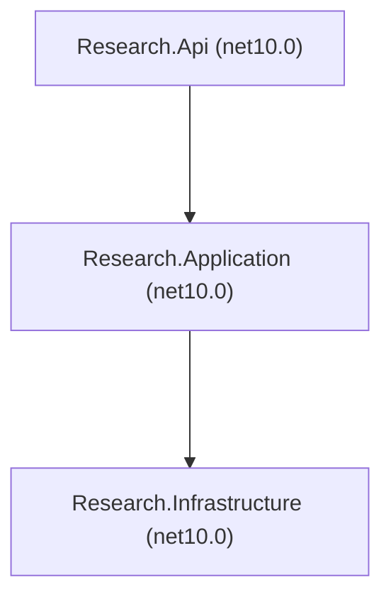

# Project references

Projects: 3; references: 2. An arrow points from a project to a project it references (<ProjectReference>).

| Project | Framework | Nullable | Nullable warnings as errors | All warnings as errors | Compiler warnings | Errors |
| --- | --- | --- | --- | --- | --- | --- |
| Research.Api | net10.0 | enable | no | no | 0 | 0 |
| Research.Application | net10.0 | enable | no | no | 0 | 0 |
| Research.Infrastructure | net10.0 | enable | yes | no | 0 | 0 |
